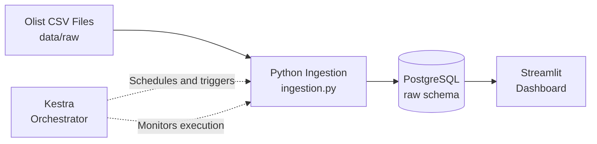

# E-Commerce Order & Delivery Analytics Pipeline

An end-to-end data engineering and analytics project built using the Brazilian E-Commerce Public Dataset by Olist.

The project focuses on raw data ingestion, PostgreSQL storage, data quality profiling, Docker containerization, and interactive analytics using Streamlit.

**Project Status:** Python Ingestion, Raw PostgreSQL Storage, Docker Integration, Data Profiling, and Dashboard are implemented. Kestra orchestration is planned and not yet integrated.

---

## 1. Project Overview

The goal of this project is to build a data pipeline that collects, stores, processes, and analyzes e-commerce order and delivery data.

The pipeline aims to:

- Ingest original CSV files using Python.
- Preserve raw data without modifying the source files.
- Store raw records in PostgreSQL.
- Track ingestion batches and execution logs.
- Prevent duplicate ingestion using SHA-256 hashing.
- Identify data quality issues.
- Provide analytical insights through a Streamlit dashboard.
- Integrate Kestra for workflow orchestration in a future stage.

## 2. System Architecture

The following diagram illustrates the project architecture:



### Architecture Components

1. **Source Data:** Original Olist CSV files.
2. **Python Ingestion:** Reads CSV files and loads records into PostgreSQL.
3. **PostgreSQL:** Stores raw data in a dedicated schema.
4. **Kestra:** Planned orchestration tool for scheduling and monitoring pipeline execution.
5. **Streamlit Dashboard:** Displays analytical insights from the database.

**Note:** Kestra is part of the target architecture but has not yet been integrated.

## 3. Dataset Description

The project uses five selected datasets from the Brazilian E-Commerce Public Dataset by Olist.

| Dataset | File Name | Records |
|---|---|---:|
| Customers | olist_customers_dataset.csv | 99,441 |
| Orders | olist_orders_dataset.csv | 99,441 |
| Order Items | olist_order_items_dataset.csv | 112,650 |
| Products | olist_products_dataset.csv | 32,951 |
| Category Translation | product_category_name_translation.csv | 71 |
| **Total** | **5 CSV files** | **344,554** |

The original files are stored in `data/raw/`.

Only these five datasets are included in the current ingestion pipeline.

## 4. Project Structure

```text
E-Commerce-Order-Delivery/
│
├── dashboard/
│   └── Dashboard chart images
│
├── data/
│   ├── raw/
│   │   └── Original CSV files
│   │
│   └── processed/
│       └── Cleaned and processed CSV files
│
├── docs/
│   ├── phase2_notes.md
│   └── raw_data_quality_report.md
│
├── logs/
│   └── ingestion.log
│
├── reports/
│   ├── raw_data_profiling_details.csv
│   └── raw_data_profiling_summary.txt
│
├── scripts/
│   ├── analytics.py
│   ├── data_quality_check.py
│   ├── ingestion.py
│   └── raw_data_profiling.py
│
├── sql/
│   ├── schema.sql
│   └── raw_schema.sql
│
├── Dockerfile.ingestion
├── docker-compose.yml
├── requirements.txt
└── app.py
```

## 5. Technologies Used

| Technology | Purpose |
|---|---|
| Python 3.11 | Data ingestion and processing |
| Pandas | Data analysis and profiling |
| PostgreSQL 16 | Relational database |
| psycopg2 | PostgreSQL connectivity |
| Docker | Containerization |
| Docker Compose | Managing multiple services |
| pgAdmin | Database administration |
| Streamlit | Interactive dashboard |
| Plotly | Data visualization |
| Matplotlib | Charts |
| Kestra | Planned workflow orchestration |

## 6. Database Design

The PostgreSQL database contains two main schemas.

### Raw Schema

The `raw` schema stores the original ingested data.

Tables:

- `raw.customers`
- `raw.orders`
- `raw.order_items`
- `raw.products`
- `raw.category_translation`
- `raw.ingestion_batches`

The five raw data tables preserve source columns as TEXT and include metadata columns:

- `source_file`
- `source_row_number`
- `ingestion_batch_id`
- `ingested_at`

The `ingestion_batches` table tracks ingestion executions, file hashes, statuses, timestamps, row counts, and error messages.

### Public Schema

The `public` schema contains the existing processed tables used by analytics:

- `public.customers`
- `public.orders`
- `public.order_items`
- `public.products`
- `public.category_translation`

The raw ingestion process is kept separate from these processed tables.

## 7. Python Ingestion Pipeline

The ingestion script is located at:

` scripts/ingestion.py `

Its main responsibilities are:

1. Read the five selected CSV files.
2. Calculate a SHA-256 hash for each source file.
3. Check whether the exact file version was previously loaded.
4. Create an ingestion batch record.
5. Validate CSV headers.
6. Load data into PostgreSQL in batches of 5,000 rows.
7. Record the number of rows read and loaded.
8. Track success or failure status.
9. Log execution details and errors.

### Duplicate Prevention

The pipeline uses SHA-256 hashing to identify unchanged files.

If the exact file version has already been loaded successfully, the pipeline skips it instead of inserting duplicate records.

This behavior was successfully tested through Docker.

## 8. Data Quality Profiling

The profiling script is:

`scripts/raw_data_profiling.py`

It checks:

- Missing values.
- Duplicate records.
- Primary key issues.
- Invalid numeric values.
- Invalid dates.
- Order status values.
- Selected foreign key relationships.

### Main Findings

- Missing order approval and delivery timestamps.
- 610 products with missing descriptive fields.
- Two products with missing physical measurements.
- Four products with a weight value of zero.
- One product overlaps between the descriptive and physical missing-value groups.

Detailed findings are documented in:

`docs/raw_data_quality_report.md`

The profiling process does not modify the original raw CSV files.

## 9. Docker Containerization

The project uses Docker Compose to manage three services:

| Service | Purpose |
|---|---|
| PostgreSQL | Database storage |
| pgAdmin | Database management |
| Ingestion | Python ingestion execution |

The ingestion Docker image is built using:

`Dockerfile.ingestion`

The ingestion service:

- Uses Python 3.11 Slim.
- Installs project dependencies.
- Connects to PostgreSQL through the Docker service hostname `postgres`.
- Mounts `data/raw/` as a read-only volume.
- Waits for PostgreSQL health checks before starting.

### Run the Ingestion Pipeline

Build the image:

```bash
docker compose build ingestion
```

Run the pipeline:

```bash
docker compose run --rm ingestion
```

The successful Docker test confirmed that all five already-ingested file versions were skipped correctly.

## 10. Dashboard

The Streamlit dashboard is launched through:

`app.py`

It connects to PostgreSQL and presents analytical insights through interactive visualizations.

The project includes analytical views related to:

- Sales performance.
- Order status distribution.
- Delivery performance.
- Customer behavior.
- Product and category performance.
- Geographical sales analysis.

Run the dashboard:

```bash
streamlit run app.py
```

## 11. Setup Instructions

### Requirements

- Python 3.11
- Docker Desktop
- Docker Compose
- The five selected Olist CSV files

### Start Database Services

```bash
docker compose up -d postgres pgadmin
```

### Build Ingestion Image

```bash
docker compose build ingestion
```

### Execute Ingestion

```bash
docker compose run --rm ingestion
```

### Run Dashboard

Activate the project's Python virtual environment, install dependencies if needed, and execute:

```bash
python -m pip install -r requirements.txt
streamlit run app.py
```


## Conclusion

This project establishes a structured e-commerce data engineering pipeline that preserves original source data, ingests records into PostgreSQL, tracks execution history, prevents duplicate ingestion, profiles data quality, and provides analytical insights through a Streamlit dashboard.

Docker provides a reproducible environment for running the ingestion service alongside PostgreSQL and pgAdmin.

Kestra integration is planned as the next orchestration improvement.